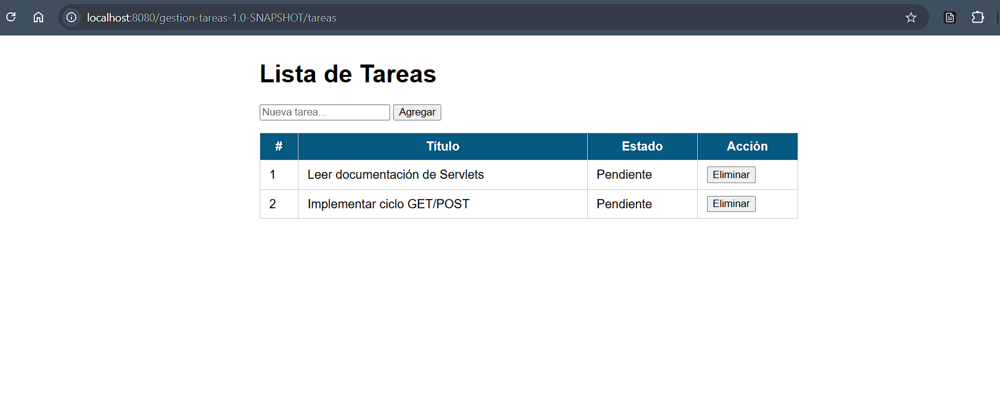
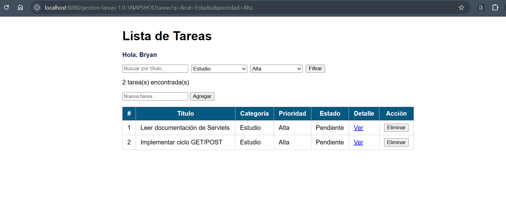
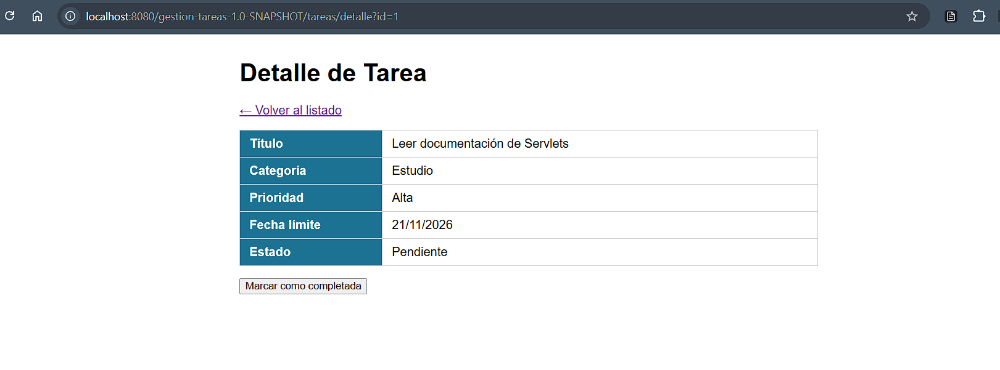

# Post-contenido — Unidad 5: Fundamentos de Java Web (Servlets y JSP)

**Estudiante:** Bryan Sneider Gelvez Toloza  
**Carrera:** Ingeniería de Sistemas — 7° Semestre  
**Universidad:** Universidad Francisco de Paula Santander (UFPS)  
**Año:** 2026  

## Descripción
Repositorio del laboratorio de la Unidad 5 de Programación Web — Séptimo Semestre (`Gelvez-post1-u5`). Un único proyecto Maven Web (`gestion-tareas`) con dos partes que extienden el mismo dominio de tareas: la Parte 1 construye el Servlet base con el ciclo GET/POST y el patrón Post/Redirect/Get; la Parte 2 le agrega filtrado combinado, vista de detalle con un segundo Servlet, y sesión para personalización y persistencia del filtro.

## Parte 1 — Servlet de gestión de tareas
`TareasServlet` procesa peticiones GET (listar) y POST (agregar, eliminar), con validación en el servidor y el patrón Post/Redirect/Get para evitar el reenvío de formularios.

## Parte 2 — Filtros, detalle y sesión
`TareasServlet` se extiende con filtrado combinado por texto, categoría y prioridad, y con las acciones `completar` e `identificar`. Se agrega `DetalleTareaServlet`, que lee la misma lista de tareas desde `applicationScope` y hace `forward` a una vista de detalle. `HttpSession` guarda el nombre del usuario identificado y el último filtro aplicado.

## Decisiones de diseño
- **Lista de tareas como variable de instancia:** La lista `tareas` es una variable de instancia en `TareasServlet` porque representa el estado compartido global de toda la aplicación (todas las peticiones deben ver y modificar la misma lista), a diferencia de los datos propios de cada petición (`titulo`, `accion`) que se manejan como variables locales dentro de `doPost`.
- **Uso de `HttpSession` vs `request`:** El filtro activo y el nombre del usuario se guardan en `HttpSession`, no en el `request`, porque deben sobrevivir a varias peticiones distintas (por ejemplo, al navegar entre `/tareas` y `/tareas/detalle` sin perder el filtro ni el saludo). La lista filtrada resultante sí se envía como atributo de `request` porque se recalcula en cada consulta.
- **Acceso mediante `applicationScope` y `forward` en el detalle:** `DetalleTareaServlet` obtiene las tareas desde el `ServletContext` (`applicationScope`) en vez de duplicar la lista en memoria, y usa `forward` en lugar de `sendRedirect` porque es una operación de lectura (`GET`) que solo necesita entregar un objeto ya encontrado en memoria a `detalle.jsp`, sin generar una segunda petición HTTP innecesaria.
- **Hoja de estilos externa:** Los estilos se extrajeron a `css/estilos.css` al agregar una segunda vista (`detalle.jsp`), evitando duplicar el bloque `<style>` embebido de la Parte 1 en cada JSP y facilitando su mantenimiento centralizado.

## Cómo compilar y desplegar
1. Clonar el repositorio: `git clone https://github.com/BryanGelvez23/Gelvez-post1-u5.git`
2. Abrir la carpeta como proyecto Maven en el IDE (VS Code, NetBeans o IntelliJ IDEA)
3. Ejecutar `mvn clean package` para generar el archivo `.war`
4. Configurar Tomcat Server (Local) y desplegar el artefacto de `gestion-tareas`

## Capturas de pantalla

### Parte 1 — Lista base de tareas (GET/POST y patrón PRG)

### Parte 2 — Lista con saludo de sesión y filtro combinado

### Parte 2 — Vista de detalle de una tarea (`DetalleTareaServlet`)
